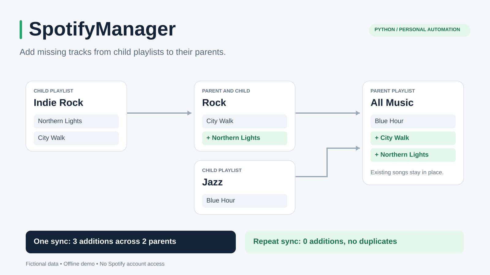

# SpotifyManager

[](https://github.com/MatheusVBellini/SpotifyManager/actions/workflows/tests.yml)
[](LICENSE)

Build larger Spotify playlists from smaller ones. SpotifyManager copies missing songs from configured child playlists into their parents, with support for multiple relationships and nested hierarchies.



Add a song to Indie Rock, and the next sync adds it to Rock and All Music. Songs already present in a parent are skipped.

## Scope

SpotifyManager is a local command-line tool for managing personal playlists through the Spotify Web API.

- **Add-only synchronization:** append missing songs without removing or reordering existing items.
- **Multiple relationships:** combine several children into one parent, or send one child to several parents.
- **Nested inheritance:** propagate songs through several levels in a single run.
- **Preview mode:** inspect proposed additions before changing playlists.
- **Scheduled operation:** run manually, keep a watcher open, or use the operating system's scheduler.
- **Recovery safeguards:** retain progress, respect API cooldowns, and check uncertain additions before allowing more writes.

Relationships refer to playlists, rather than Spotify's playlist folders. Synchronization flows from children to parents; it does not copy changes back down, mirror deletions, or remove existing duplicates. The first sync includes songs already in the children. Later changes are picked up by the next successful run, rather than immediately when a song is added in Spotify.

## Try the demo

After installation, run a small example with fictional playlists. It exercises the same synchronization logic with an in-memory Spotify substitute: no account, credentials, network requests, or changes to personal settings are needed.

Windows:

```powershell
.\.venv\Scripts\python.exe examples/demo.py
```

macOS and Linux:

```bash
.venv/bin/python examples/demo.py
```

The demo previews three additions, synchronizes two levels of parents, and runs again to show that no items are added twice. See the [walkthrough](docs/demo.md) for the input and results.

## Requirements

- Python **3.10 or newer**, with `venv` and `pip` support.
- Windows, macOS, or Linux.
- A Spotify developer app and an account authorized to use it.
- Ownership or collaborator access to every configured playlist, including permission to edit the parents.
- Internet access for authorization and synchronization.

The application uses Python's standard library and requires no third-party Python packages. `requirements.txt` is the dependency manifest used by setup.

For current Spotify Development Mode apps, the app owner needs **Spotify Premium**, and the app supports up to **five authorized users**. Accounts must be on the app's allowlist. Following a public playlist alone does not grant access to its items through the current endpoint. Check Spotify's [quota modes](https://developer.spotify.com/documentation/web-api/concepts/quota-modes) and [playlist access requirements](https://developer.spotify.com/documentation/web-api/reference/get-playlists-items) before setting up an app. These requirements were reviewed on October 10, 2026.

## Installation

Clone the repository:

```console
git clone https://github.com/MatheusVBellini/SpotifyManager.git
cd SpotifyManager
```

Alternatively, download and extract the repository ZIP, then open a terminal in the folder containing `setup_env.py`. Run the following setup commands from that folder.

### Windows

Install [Python](https://www.python.org/downloads/windows/), then open PowerShell in the project folder:

```powershell
python --version
python setup_env.py
```

If Python is available through the `py` launcher instead, use:

```powershell
py -3 --version
py -3 setup_env.py
```

### macOS

Install a supported Python version from the [macOS downloads page](https://www.python.org/downloads/macos/). With the python.org installer, also run **Install Certificates.command** from its Python folder in Applications to enable HTTPS connections. See the [official macOS installation guide](https://docs.python.org/3/using/mac.html).

In Terminal, from the project folder:

```bash
python3 --version
python3 setup_env.py
```

### Linux

Install Python 3.10 or newer with virtual environment support. On Ubuntu or Debian:

```bash
sudo apt update
sudo apt install python3 python3-venv
```

For other distributions, use the distribution's package manager to install Python and its `venv`/`pip` support. [Ubuntu's Python guide](https://ubuntu.com/developers/docs/howto/python-setup/) provides additional setup information.

```bash
python3 --version
python3 setup_env.py
```

### Local environment

Setup creates `.venv` inside the project, installs `requirements.txt`, and creates missing settings files from the example templates. Existing settings are preserved. No environment activation is needed for the commands in this guide: they select the project interpreter directly.

If the project is moved or installed on another computer, recreate `.venv` in its new location using `setup_env.py`. Virtual environments depend on their original paths and base Python installation; see the [Python venv documentation](https://docs.python.org/3/library/venv.html).

## Spotify app setup

1. Open the [Spotify Developer Dashboard](https://developer.spotify.com/dashboard) and create an app, or select an existing one.
2. Select **Web API** when choosing the API type.
3. Add this redirect URI in the app settings:

   ```text
   http://127.0.0.1:8888/callback
   ```

4. Copy the app's **Client ID**.
5. In **Users Management**, ensure the Spotify account used for synchronization is allowed to use the app.

Authorization uses [Authorization Code with PKCE](https://developer.spotify.com/documentation/web-api/tutorials/code-pkce-flow), so no client secret is required. Keep the configured redirect URI consistent with the app settings. Spotify permits HTTP for explicit loopback addresses such as `127.0.0.1`, but does not accept `localhost`. [Redirect URI requirements](https://developer.spotify.com/documentation/web-api/concepts/redirect_uri).

The authorization requests these permissions: `playlist-read-private`, `playlist-read-collaborative`, `playlist-modify-private`, and `playlist-modify-public`. See Spotify's [scope documentation](https://developer.spotify.com/documentation/web-api/concepts/scopes).

## Configuration

Two JSON files separate Spotify app settings from playlist relationships.

### App settings: `credentials.json`

Set the Client ID copied from the developer dashboard:

```json
{
  "client_id": "PASTE_YOUR_SPOTIFY_CLIENT_ID_HERE",
  "redirect_uri": "http://127.0.0.1:8888/callback"
}
```

Setup creates this file from `credentials.example.json` if it is missing. Account access and refresh tokens are saved in `.spotify-sync/` after authorization. Keep those tokens private; later runs refresh authorization automatically when possible.

### Playlist relationships: `config.json`

For a first-time installation, use `config.example.json` as the starting point and replace every playlist reference with the intended playlists. When updating an existing installation, keep the configured file.

Setup creates `config.json` from the template when it is missing. Each installation keeps its own playlist settings.

To start from the template on Windows:

```powershell
Copy-Item config.example.json config.json
```

On macOS or Linux:

```bash
cp config.example.json config.json
```

These copy commands replace `config.json`. Edit it before running authorization or synchronization. In Spotify, use **Share → Copy link to playlist** to obtain each reference.

```json
{
  "include_episodes": false,
  "relationships": [
    {
      "_comment": "All Music receives Rock and Jazz",
      "parent": "PASTE_ALL_MUSIC_PLAYLIST_URL_OR_ID",
      "children": [
        "PASTE_ROCK_PLAYLIST_URL_OR_ID",
        "PASTE_JAZZ_PLAYLIST_URL_OR_ID"
      ]
    },
    {
      "_comment": "Rock receives Indie Rock",
      "parent": "PASTE_ROCK_PLAYLIST_URL_OR_ID",
      "children": ["PASTE_INDIE_ROCK_PLAYLIST_URL_OR_ID"]
    }
  ]
}
```

| Setting | Meaning |
| --- | --- |
| `parent` | Playlist that receives missing items. |
| `children` | Playlists that supply items to that parent. |
| `include_episodes` | Set to `true` to include podcast episodes; defaults to `false`. |
| `_comment` | Optional descriptive text, ignored by the script. |

Playlist URLs, 22-character IDs, and `spotify:playlist:...` URIs are accepted. Standard JSON does not support `#` or `//` comments or trailing commas; use `_comment` fields for notes.

List the direct children of each parent. In the example, Indie Rock reaches All Music through Rock, so it does not need another relationship directly to All Music. Nested relationships are processed in the correct order regardless of their order in the file. Cycles and self-references are rejected.

## Usage

Run the following commands **one at a time**, after configuring both JSON files.

### Windows

```powershell
.\.venv\Scripts\python.exe run.py auth
.\.venv\Scripts\python.exe run.py sync --dry-run
.\.venv\Scripts\python.exe run.py sync
```

### macOS and Linux

```bash
.venv/bin/python run.py auth
.venv/bin/python run.py sync --dry-run
.venv/bin/python run.py sync
```

| Command | Behavior |
| --- | --- |
| `auth` | Opens a browser for Spotify login and permission approval. |
| `sync --dry-run` | Reads playlists and previews additions without writing to Spotify playlists. |
| `sync` | Runs one synchronization and exits. |

During authorization, sign in to the account with access to the configured playlists and finish within five minutes. If the browser does not open, add `--no-browser` and open the printed URL in a browser on the same computer. Reauthorize if access is revoked or token refresh fails.

The preview shows missing-item counts and `Would add` messages, including propagation through nested parents. It still makes API requests and may refresh tokens or update local cache/recovery state, so it consumes API quota.

Run `sync` again to check for new songs, or configure a schedule below. Removing a song from a child does not remove it from a parent. Removing it from a parent while it remains in a child makes it eligible to be added again.

### Options and logging

Use `--log-file sync.log` to append logs, or `--config` and `--credentials` to choose different settings files. For example, on macOS or Linux:

```bash
.venv/bin/python run.py sync --config other-playlists.json --credentials credentials.other.json --dry-run
.venv/bin/python run.py sync --log-file sync.log
.venv/bin/python run.py --help
```

On Windows, use `.\.venv\Scripts\python.exe` in place of `.venv/bin/python`. Explicit relative file paths are resolved from the terminal's current folder. Default settings are located beside the application; credentials default to `credentials.json` beside the selected configuration.

## Automatic synchronization

Authorize and complete a manual sync before scheduling. Use the same operating system account for setup, authorization, and scheduling. A daily schedule is a conservative starting point; more frequent checks consume more API quota. Choose one scheduling method for each installation.

### Windows: Task Scheduler

From PowerShell in the project folder, register a daily task:

```powershell
powershell.exe -NoProfile -ExecutionPolicy Bypass -File .\register-task.ps1 -EveryMinutes 1440
```

This creates **SpotifyManager Playlist Sync**, with its first run about one minute after registration and a repeat interval of 24 hours. Use another value from **5 to 1440** for a different interval in minutes. It uses the project interpreter directly and runs while the account is logged in and the computer is awake. Missed starts can run when the computer becomes available again; overlapping scheduled runs are ignored.

Check the task and recent logs:

```powershell
Get-ScheduledTaskInfo -TaskName 'SpotifyManager Playlist Sync'
Get-Content -LiteralPath '.\sync.log' -Tail 30
```

Manage the task with:

```powershell
Disable-ScheduledTask -TaskName 'SpotifyManager Playlist Sync'
Enable-ScheduledTask -TaskName 'SpotifyManager Playlist Sync'
Unregister-ScheduledTask -TaskName 'SpotifyManager Playlist Sync'
```

To change the interval or project location, remove the old task and register it again. The helper refuses to overwrite an existing task. For a manual run with logging, use `powershell.exe -NoProfile -ExecutionPolicy Bypass -File .\run-sync.ps1`; add `-Preview` to preview additions.

### macOS: launchd

From Terminal in the project folder, create a user LaunchAgent for **18:00 every day**. The following generates paths from the current folder, including folder names containing spaces:

```bash
.venv/bin/python - <<'PY'
from pathlib import Path
import plistlib

root = Path.cwd().resolve()
agent = Path.home() / "Library/LaunchAgents/local.spotifymanager.sync.plist"
agent.parent.mkdir(parents=True, exist_ok=True)
settings = {
    "Label": "local.spotifymanager.sync",
    "ProgramArguments": ["/bin/bash", str(root / "run-sync.sh")],
    "WorkingDirectory": str(root),
    "StartCalendarInterval": {"Hour": 18, "Minute": 0},
    "StandardOutPath": str(root / "scheduler.log"),
    "StandardErrorPath": str(root / "scheduler.log"),
}
with agent.open("wb") as handle:
    plistlib.dump(settings, handle)
agent.chmod(0o600)
print(agent)
PY

launchctl bootstrap "gui/$(id -u)" "$HOME/Library/LaunchAgents/local.spotifymanager.sync.plist"
```

Change `Hour` and `Minute` before creating the file to select another time. This user agent runs while the account is logged in. A calendar run missed during sleep is handled after waking; a run missed while powered off waits until the next scheduled time. See Apple's [scheduled jobs guide](https://developer.apple.com/library/archive/documentation/MacOSX/Conceptual/BPSystemStartup/Chapters/ScheduledJobs.html) and [LaunchAgent documentation](https://support.apple.com/guide/terminal/apdc6c1077b-5d5d-4d35-9c19-60f2397b2369/mac).

Check its status and logs:

```bash
launchctl print "gui/$(id -u)/local.spotifymanager.sync"
tail -n 30 sync.log
```

Unload it before changing its schedule or moving the project:

```bash
launchctl bootout "gui/$(id -u)" "$HOME/Library/LaunchAgents/local.spotifymanager.sync.plist"
```

Then regenerate and load it again. To remove scheduling permanently, unload it and delete `local.spotifymanager.sync.plist` from `~/Library/LaunchAgents`.

### Linux: cron

From the project folder, generate an entry for **18:00 every day**:

```bash
printf '0 18 * * * /bin/bash "%s/run-sync.sh"\n' "$(pwd -P)"
crontab -e
```

Paste the printed line into the crontab and save it. It uses an absolute project path and writes to `sync.log`. The machine must be running at the scheduled time; cron does not catch up on missed runs. The schedule uses the machine's local time. Ensure the cron service is installed and enabled for the distribution.

To change or remove the schedule, edit the entry with `crontab -e`. If the project moves, regenerate the entry after recreating `.venv`.

### Alternative: terminal watcher

Keep a terminal open to repeat synchronization, waiting 24 hours after each run:

```powershell
.\.venv\Scripts\python.exe run.py sync --watch 86400 --log-file sync.log
```

On macOS or Linux:

```bash
.venv/bin/python run.py sync --watch 86400 --log-file sync.log
```

`--watch` accepts an interval in seconds, with a minimum of 300. Press **Ctrl+C** to stop. Transient failures are retried on a later cycle; errors requiring attention stop the watcher. The terminal must remain open and the computer must stay running.

## Troubleshooting

| Problem | Resolution |
| --- | --- |
| Windows says Python was not found | Install Python, reopen PowerShell, and try `py -3 setup_env.py`. After setup, use the explicit `.venv` interpreter shown above. |
| Missing or invalid virtual environment | Run setup; if the project was moved, move the old `.venv` aside and recreate it. |
| HTTPS certificate error on macOS | Run **Install Certificates.command** supplied with the python.org installer. |
| Invalid JSON | Remove comments/trailing commas; use double-quoted strings and JSON booleans `true`/`false`. |
| Invalid Client ID or playlist reference | Replace all placeholders in both settings files. |
| Authorization fails | Check the Client ID, exact redirect URI, account allowlist, and browser callback. |
| HTTP 401 | Run `auth` again if token refresh cannot restore access. |
| HTTP 403 | Check the app owner's Premium status, allowlist, scopes, and playlist ownership/collaboration permissions. |
| HTTP 404 | Check the playlist reference and account access. |
| Another instance holds the lock | Wait for the current run to finish, or stop the other watcher. |
| Scheduled run fails | Inspect `sync.log`; on macOS also inspect `scheduler.log`. Check the interpreter and project paths. |

Logs append over time. Archive or truncate them periodically while no run is active.

### API rate limits and quota cooldowns

Spotify applies both short-term [rate limits](https://developer.spotify.com/documentation/web-api/concepts/rate-limits) and Development Mode [request quotas](https://developer.spotify.com/documentation/web-api/concepts/quota-modes). Development quotas are shared across apps belonging to the same developer account; creating another app does not provide an independent allowance.

For `QUOTA_EXCEEDED`, SpotifyManager saves a retry deadline. Scheduled runs and the watcher make no Spotify requests during the cooldown, and the next run after the deadline retries automatically. **No manual `resume` command is normally needed.**

The cooldown honors `Retry-After`, with a minimum of one hour. Repeated quota failures increase that minimum to 2, 4, 8, 16, and then 24 hours. Longer server-requested cooldowns take precedence. A successful sync or preview resets this backoff. The script does not assume a fixed quota reset time.

Increase the scheduling interval if limits recur. Repeated previews also consume requests. The optional `resume` command preserves the cooldown deadline and pending additions; it cannot increase the allowance or enable an early retry.

### Uncertain additions

If an addition times out, returns a server error, or cannot be confirmed in fresh playlist contents, the script saves the pending batch and stops further writes. A later sync checks it again and continues automatically when all items are present.

If items remain absent, wait for Spotify to settle and inspect the affected parent. Once the original request is known to be resolved, acknowledge the pending batch and preview again:

```powershell
.\.venv\Scripts\python.exe run.py acknowledge-pending
.\.venv\Scripts\python.exe run.py sync --dry-run
.\.venv\Scripts\python.exe run.py sync
```

On macOS or Linux, replace `.\.venv\Scripts\python.exe` with `.venv/bin/python`.

Acknowledgement performs another read, then clears the pending record even if items are absent. A later sync may add them. Only acknowledge after resolving the uncertainty: a late original addition could otherwise create duplicates. Keep `.spotify-sync/` intact so the recovery checks retain their state.

## Behavior and limitations

- Duplicate checks use Spotify item URIs, including relinking aliases when available. Different releases or remasters can remain separate items, and existing duplicates are preserved.
- Local files, null items, and unsupported entries are skipped and reported. Catalog availability for playback can vary by country.
- Playlist snapshot checks detect changes during reads and before append batches. Changes made to children during a run are picked up on a later run.
- A partial failure does not undo confirmed additions. Subsequent runs compare against current playlist contents.
- Spotify's append endpoint does not offer an idempotency key or conditional snapshot parameter. Concurrent edits by other apps/users, or a very late uncertain request, can still cause duplicates. Use one manager for overlapping parent playlists.
- The project uses the current `/playlists/{id}/items` endpoints. Spotify API permissions and quotas can change independently of this application.

| Exit code | Meaning |
| --- | --- |
| `0` | Completed successfully. |
| `1` | Transient failure, cooldown, or lock contention. |
| `2` | Configuration, authorization, or recovery issue requiring attention. |
| `130` | Interrupted. |

## Tests

The test suite uses simulated Spotify responses and does not access an account.

Windows:

```powershell
.\.venv\Scripts\python.exe -m unittest discover -s tests -v
```

macOS and Linux:

```bash
.venv/bin/python -m unittest discover -s tests -v
```

Tests cover configuration, setup, authorization, nested propagation, duplicate checks, pagination, caching, rate limits, quota recovery, locking, and uncertain additions. GitHub Actions runs the suite and offline demo on Windows, macOS, and Linux with Python 3.10 and 3.13.

## License

SpotifyManager is available under the [PolyForm Noncommercial License 1.0.0](LICENSE). It permits noncommercial use, modification, and distribution under its terms. Commercial use or distribution requires separate permission from the copyright holder. This is a source-available project with a commercial restriction.

[Copyright notice](NOTICE.md). Licensing requests can be directed to [Matheus V Bellini](https://github.com/MatheusVBellini).
